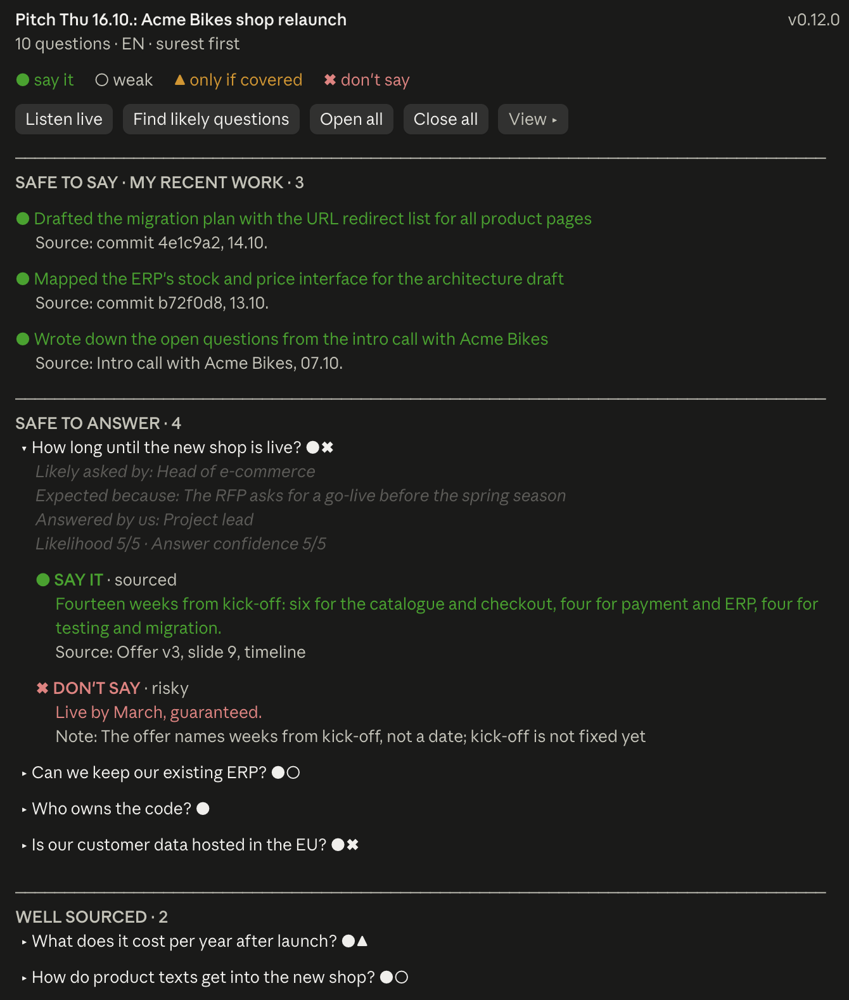
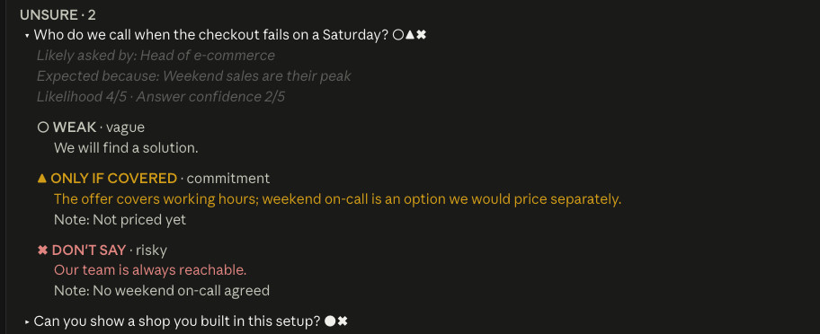
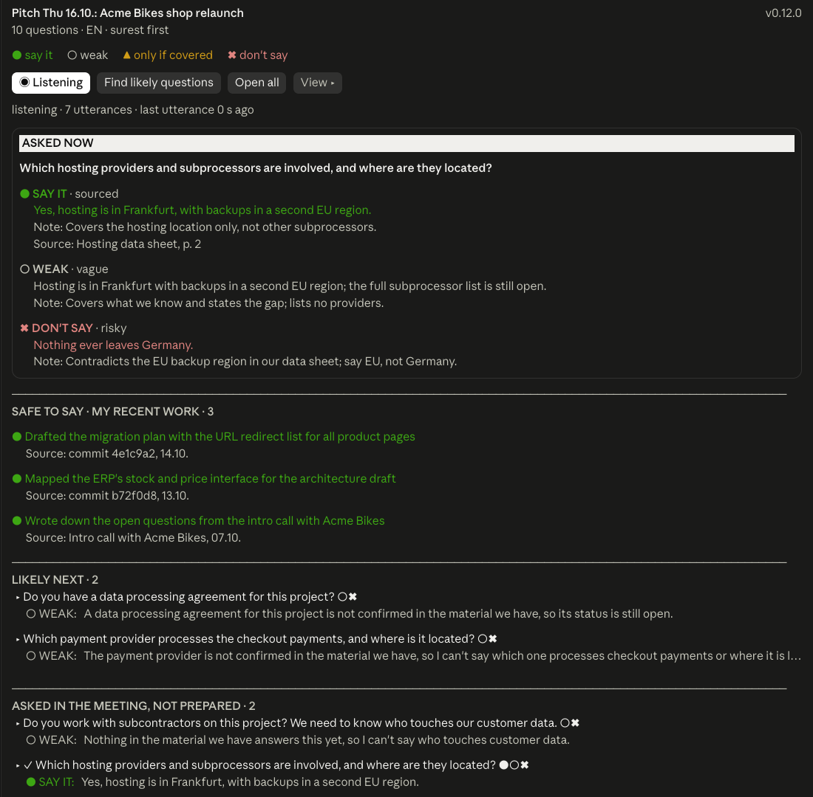
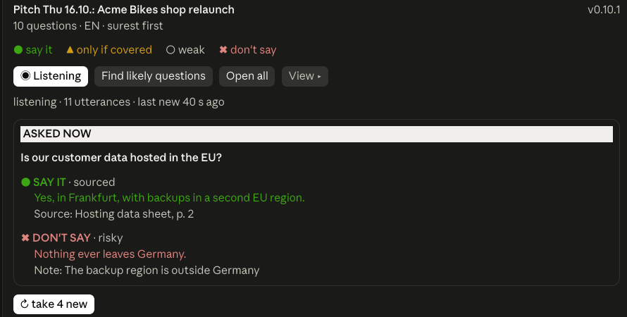

# Great Question

**Know the question before it is asked, and what you can safely say.**

[](https://github.com/jsc2304/great-question/releases)
[](LICENSE)
[](#requirements)

A side panel for Claude Code. Before a pitch, a customer meeting or the daily stand-up, it reads your repository, your tickets and, with Wispr Flow, earlier meetings, and shows the questions most likely to come up, each with answers ranked by risk and the source they rest on. During the meeting it listens along and predicts live which questions come next, with their answers ready before anyone asks.

- **Prepare any meeting** with one command: likely questions, who asks them and why, and answers with their sources. No Wispr Flow needed.
- **Answer safely:** every answer is marked *say it*, *weak*, *only if covered* or *don't say*, and the panel always offers something that is true and promises nothing, from what you worked on last.
- **Predict questions live** during the meeting with [Wispr Flow](https://wisprflow.ai) (macOS): the question just asked jumps to the top with its answers, looked up in your repository, and the questions likely to come next appear with their answers before they are asked.

## Quick start

```
/plugin install great-question --marketplace jsc2304/great-question
```

Then, in the repository you work in:

```
/great-question-prep today's daily
```

The panel opens and the questions appear when the background agent is done. For a meeting, name it instead: `/great-question-prep customer pitch Thursday`. More under [Installation](#installation) and [Usage](#usage).

Every answer carries its risk as a mark, a word and a colour, safest first:

| Mark | Meaning |
|---|---|
| ● **SAY IT** · sourced | well founded, with a source |
| ○ **WEAK** · vague | true and binds us to nothing, but shallow |
| ▲ **ONLY IF COVERED** · commitment | binds us (date, price, scope); say it only when the documents back it |
| ✖ **DON'T SAY** · risky | unsupported, attackable or contradicting the documents |

## What it looks like

A pitch prepared: what you worked on last as safe to say, then questions grouped by how surely they can be answered, each with its risk marks. An opened question says who is likely to ask, why, who answers on our side, and offers answers by risk, with their sources:



Where the documents give no firm answer, the panel offers, safest first, what is harmless but shallow, what you may promise only if it is covered, and what to leave out:



Listening along: the question just asked appears with answers by risk, your recent work stays on show as safe to say, and the next likely questions appear below, each with its safest answer in one line:



While a question is open, new ones wait behind a button instead of moving the list:



The pictures show the 0.12 layout. Since 0.13 the question asked now is drawn as a large card at the top, and the sections below it are folded while listening.

*Screenshots show a fictional pitch for a fictional company; no real meeting was recorded.*

## Requirements

- **Claude Code** in the terminal or the desktop app, tested with version 2.1.296.
- **Wispr Flow for the full feature set.** Without Wispr Flow, Great Question prepares questions from the repository, tickets and other connected sources. With Wispr Flow you also get:
  - **Listening along:** while a recording runs, it reads the live transcript of the Wispr Flow app (Meeting Recorder, macOS) and suggests questions from the last two minutes.
  - **Meetings and transcripts during preparation:** through the Wispr Flow connector in Claude Code, `/great-question-prep` finds the upcoming meeting with its attendees and earlier conversations with the other side.

## Installation

In a Claude Code session in the terminal, enter:

```
/plugin install great-question --marketplace jsc2304/great-question
```

Confirm the marketplace question with `y` and choose the scope **User** (Enter). The mod then applies to all projects, including sessions in the desktop app.

Without a running session, use the shell:

```bash
claude plugin marketplace add jsc2304/great-question
```

```bash
claude plugin install great-question@great-question --scope user
```

Sessions that were running before the installation only see the mod after a restart.

## Updating

```bash
claude plugin update great-question@great-question
```

Then restart the session. The loaded version is shown top right in the panel (for example `v0.9.0`).

## Usage

| Command | Effect |
|---|---|
| `/great-question` | opens the panel without generating anything |
| `/great-question-prep [occasion]` | finds likely questions with answers in the background, for example `/great-question-prep steering committee Thursday` |

The desktop app does not list these commands in its suggestions. Type them in full and press Enter.

With nothing prepared yet, the panel asks where to start: **Likely questions about <folder>**, **Prepare my next meeting** (the background agent finds it in your calendar) or **Prepare today's daily**. Or just **Listen live**: questions then come from the live transcript only, answers from the repository.

Sources and the sources of answers are links where they point somewhere: a URL, a GitHub issue or pull request (`owner/repo#12`, `#12`), or a repository file, which opens on GitHub at its line (`docs/ops.md:12`). A file path counts from the session's folder; it becomes a link only when the file exists there and its repository's default branch on GitHub has it, otherwise it stays plain text.

Buttons in the panel:

- **Listen live**: checks the running Wispr Flow recording every 3 seconds and shows the question asked now as a card, **UP NEXT · FOR YOU**, **SAFE TO SAY · MY RECENT WORK** and **ASKED EARLIER**. While listening, the button carries the status, for example "◉ Listening · 212 utterances · 12 s ago". Switching it off only pauses.
- **Find likely questions**: like `/great-question-prep` without an occasion. A background agent reads the repository, connected sources and the newest 12,000 characters of this session's conversation (text only, no tool output) while your session stays free; the panel shows a turning ◐ with the time taken, and the questions appear when it is done.
- **Open all** and **Close all**: open or close every visible question. **Close all** shows as soon as one question is open and closes them all at once.
- **More**: shows the less frequent settings and actions:
  - **Language: Auto / DE / EN** of questions and answers. *Auto* uses the language the meeting is held in (from the invitation, slides and earlier transcripts when generating, from the conversation when listening). Applies to everything generated from then on, live included; nothing already shown is translated. Notes and reasons are in English.
  - **Model**: who answers while listening and how hard it thinks: *Fast (Haiku)*, *Balanced (Sonnet, low effort)* or *Thorough (Sonnet, high effort)*. Applies to the live step, the answers from the repository and the model of the ASKED NOW lookup; the background preparation keeps the session's model. Slower levels answer later: a step still running when the next is due is skipped.
  - **Sort**: by answer confidence (*safest to answer*) or by likelihood (*most likely asked*).
  - **Meeting / Practice**: *Meeting* shows the strongest first, *Practice* turns the order round and puts the weakest questions on top.
  - **Legend**: what the risk marks mean.
  - **Export**: writes the panel as Markdown to `question-sets/YYYY-MM-DD-HHMM-<title>.md` in the project folder.
  - **Clear** (only while paused): deletes the live results.

While listening, the panel follows the questions you have to answer:

- New lines are checked every 3 seconds. A question mark, your name, a question word at the start or a tag such as "oder?" or "right?" starts a step at once; other lines wait at most 12 seconds.
- A step has two parts. A quick one finds which questions were asked, which one is on the table, who it is for and what comes next, and shows them at once, the new rows marked *answering …*. A second one then writes 2–3 answers per question, safest first. Meanwhile the next question can already be detected.
- Every question says who it is for (you, everyone or someone else) and who asked, by role or first name as heard. Questions to someone else are listed with that mark but never take the card at the top. In a video call your voice is the microphone; your git user name helps the model spot questions addressed to you by name.
- The question asked now gets a card: **ASKED OF YOU**, **ASKED · EVERYONE** or **ASKED NOW**, who asked and how long ago, the best answer with its source, one *✖ Don't say* line, and the other answers behind *▸ N more answers*. In the desktop app the card uses larger text; the terminal keeps one size.
- **UP NEXT · FOR YOU** shows at most 3 questions likely to come next: yours first, marked *· you*, then by likelihood, then newest, each with its best answer in one line.
- **SAFE TO SAY · MY RECENT WORK** lists what you worked on last, true whatever is asked: from the preparation (commits, pull requests, tickets or meetings, each with its source), or, when the preparation has none, your last five commits in the folder (author = your git email, merges left out).
- Live answers come safest first. A closed question shows the one that binds you to nothing before a promise; a commitment is offered only when the question asks for a date, an owner or a scope, and never with a date or name nobody gave.

While listening, answers come from the repository too:

- For every new question from the call, the mod searches the session's repository for its key words (`git grep`, exports left out). The answers are written from the lines found, the prepared questions, your recent work and the briefing (see [Data and confidentiality](#data-and-confidentiality)). A **SAY IT** answer then names its file and line, for example `docs/offer.md:42`.
- For the question asked now, unless the prepared answers already rest on sources, a read-only subagent looks it up in more depth, alongside the two parts of the step. While it runs, the card says *checking the repository …*; its answers then replace the quick ones, marked *from the repository*.
- Only the repository is searched live. Slides in Drive, Jira and other connected sources come in through the preparation only.

While listening, the list only grows, it is never rebuilt:

- New questions arrive closed and show their best answer in one line. A question keeps its wording even when the model rephrases it slightly.
- Below **UP NEXT**, four sections are folded to one line each: **SAFE TO SAY · MY RECENT WORK**, **ASKED EARLIER** (questions from the call that were not prepared, newest first), **PREPARED** (the prepared questions, grouped as before, with the sort order in its title) and **SOURCES**. A press on a section title unfolds it. Paused, **PREPARED** and **SAFE TO SAY** stand open.
- An asked question stays in place, marked ✓. Only when paused does it move to **ALREADY ASKED**.
- While a question is open, the live sections stand still. New ones collect behind **↻ take N new** in the title row of **UP NEXT** and arrive by themselves once all questions are closed. The card for the question asked now always stays live.

What gets prepared depends on the project: with slides, a pitch preparation or a meeting at hand it prepares the meeting; otherwise the daily stand-up from commits, pull requests and open tickets.

## Data and confidentiality

- **Record only with consent.** Wispr Flow records through this computer's microphone and system audio; no bot appears in the video call, so the others cannot see that it is being transcribed. Get the consent of everyone in the meeting before recording. In Germany, recording the privately spoken word without consent is a criminal offence (§ 201 StGB).
- **Transcription by Wispr Flow.** Recording happens locally, transcription happens in Wispr Flow's cloud ([Wispr: on-device recording](https://wisprflow.ai/notetaker/what-is-on-device-recording), as of 14.10.2026). Great Question reads the finished transcript from the Wispr Flow app's local file.
- **Prepared questions** are stored locally per project folder. They stay on the computer. A new session does not reopen them by itself: the panel asks first whether to show them, prepare new ones or listen live.
- **Listening along** sends the last two minutes of the transcript, the prepared questions, the repository lines found for new questions, your git user name, your last five commit subjects and a briefing from the folder to a Claude model through the same access as the session: Haiku by default, Sonnet when chosen under **More → Model**. The briefing holds, when they exist, the sections "Status", "Offene Fäden" and "Tickets" of the project's Second Brain hub (`~/projects/second-brain/projects/<repo>/<repo>.md`, 8,000 characters, first; it wins on a ticket's state), the first 6,000 characters of `memory/MEMORY.md`, the two newest files in `memory/daily-logs/` (3,000 characters each) and the last 15 commit subjects, at most 24,000 characters, re-read at most once a minute. A lookup for the question asked now runs as a read-only subagent with the same model in the session's folder. Speaker names from Wispr Flow are not sent; names mentioned in the conversation are in the text.
- **Training data, only when you ask for it.** If the folder `~/.claude/great-question/labels/` exists, listening appends every step's decisions to `<day>.jsonl` in it: the two-minute transcript excerpt, your git user name, the questions listed at that moment and what the model decided (which questions were asked, whom they were for, what comes next). The rows are meant for training a local decision model and stay on the computer. Without the folder nothing is written; delete it to stop.
- **Exports** with live results contain questions from the conversation, names included. In projects with confidential content, add `question-sets/` to `.gitignore` or review it before committing.

## Development

Check:

```bash
claude plugin validate .
```

```bash
claude plugin test .
```

A change reaches running sessions only with a release, since the mod installs from this repository on GitHub: raise `version` in `.claude-plugin/plugin.json` and add the `CHANGELOG.md` section in the same pull request, merge, tag `vX.Y.Z`, then run `claude plugin marketplace update great-question` and `claude plugin update great-question@great-question` and restart the session. The desktop app loads the mod from the plugin cache, not from the working folder, so unmerged work never reaches it; test it with `claude plugin test .`.

| File | Contents |
|---|---|
| `hooks/register.tsx` | commands, the question-set tool, panel, export |
| `hooks/live.ts` | listening along: read the transcript, fold in the model's reply |
| `types/index.d.ts` | data types and the panel's state |
| `tests/` | tests for panel, export and listening along |

## Feedback

Questions, ideas and meeting stories go to [Discussions](https://github.com/jsc2304/great-question/discussions); bugs to [Issues](https://github.com/jsc2304/great-question/issues). If Great Question saved you in a meeting, a star helps others find it.

## License

MIT, see [LICENSE](LICENSE).
